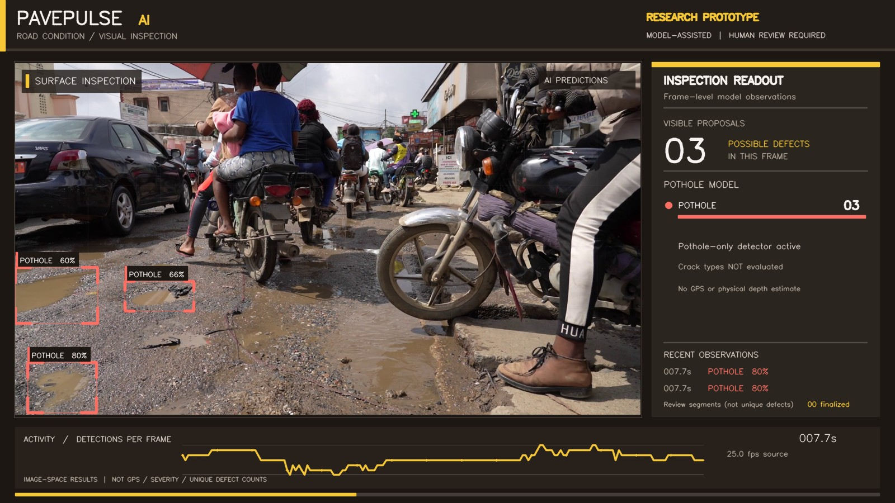

# PavePulse AI — Intelligent Road Surface Inspection

**An automated road-defect screening prototype for sustainable smart-city maintenance.**

**Python · Specialized YOLOv8s pothole model · Optional RDD2022 4-class detector · OpenCV · NumPy · Matplotlib · Hugging Face**

> **Research prototype, not a road-safety certification, GPS survey, severity assessment, or validated municipal inspection system.** It highlights *possible* defects for human review. Only the model can decide whether a detection is present; PavePulse does not insert fake detection labels.

## Why PavePulse?

City road maintenance often requires labor-intensive inspections. PavePulse explores whether computer vision can flag **candidate potholes and asphalt cracks from roadway footage** and produce a **time-indexed review record**. A real city deployment would additionally require road-network coordinates, calibration, human validation, a tested model for local roads, and a maintenance-management system.

This project connects smart mobility and sustainable infrastructure research (particularly **UN SDG 9 and SDG 11**) with an accessible, reproducible Python demonstration.

## What makes this different from standard YOLO video demos?

- **A pothole-specialist YOLOv8s by default**, with an optional RDD2022 four-class model; never the default COCO person/vehicle detector.
- **Automatic pothole detection** in default mode; choose the RDD2022 model separately for four pavement-damage categories.
- **Field-inspection video layout**: road footage in a large left viewport, readable review panel on the right, diagnostic timeline at the bottom, amber engineering aesthetic — a different presentation from conventional YOLO count dashboards.
- **Precision corner-style highlighting**, label + model confidence for each predicted region.
- **Per-frame observation timeline** and model detections CSV.
- **Temporal *review segments*** that group nearby time intervals by defect class for a human inspector. They are not counts of unique physical defects.
- **H.264-encoded MP4 export** for convenient portfolio/LinkedIn sharing (falls back to mp4v if FFmpeg transcoding fails).
- **No manual zone drawing, line marking, annotation or training.**

### Optional four-class RDD2022 model categories

| Class | Description | Dashboard color |
|---|---|---|
| `pothole` / D40 | Possible pothole | Coral |
| `longitudinal_crack` / D00 | Crack along roadway direction | Amber |
| `transverse_crack` / D10 | Crack crossing roadway direction | Teal |
| `alligator_crack` / D20 | Network-like cracking | Violet |

The default Samdutse model predicts **pothole only**; the dashboard labels this mode accordingly and does **not** claim crack detection. These four classes apply only to the optional RDD2022 model. The UI rejects generic COCO weights.

## Windows installation

Run in **PowerShell** from your projects directory:

```powershell
cd D:\Personal\github_projects
Expand-Archive -Path .\PavePulse_AI_Complete.zip -DestinationPath . -Force
cd .\PavePulse_AI

py -3.13 -m venv .venv
.\.venv\Scripts\Activate.ps1
python -m pip install --upgrade pip
python -m pip install -r requirements.txt
python -m unittest discover -s tests -v
```

If PowerShell blocks activation, run `Set-ExecutionPolicy -Scope Process -ExecutionPolicy RemoteSigned`, or call `.\.venv\Scripts\python.exe` directly without activating.

Tested project code with Python and OpenCV in the build environment; **real pretrained-model inference needs to be checked on your Windows machine** after downloading weights.

## Download a suitable video

**Important: choose clear footage of actual asphalt potholes or cracks**, not just traffic, dirt roads, distant road surfaces, or construction vehicles. A dashcam-like ground-level or near-ground-level view is preferable. Real model detections may be zero on unsuitable footage.

Pexels example links:

- [Motorbikes navigating a pothole on an urban road](https://www.pexels.com/video/motorbikes-navigating-a-pothole-in-urban-street-34218247/) — very visible damaged/water-filled road section; **challenging** because water and motorcycles may obscure the defect.
- [Cracks on an asphalt road](https://www.pexels.com/video/cracks-on-asphalt-road-built-for-crossing-the-desert-3058756/) — 23-second HD clip; cracks may be distant depending on framing.
- [Search Pexels for pothole footage](https://www.pexels.com/search/videos/potholes/).

Use footage you have permission to adapt and publish; read the source's current license and restrictions. Do not redistribute original footage through the repo without permission.

Save as **`input\road.mp4`**. The original video is excluded by `.gitignore`.

## Run your first test

```powershell
# Test just the first 5 seconds:
python pavepulse.py --input input/road.mp4 --output outputs --device cpu --max-seconds 5 --show

# Full video:
python pavepulse.py --input input/road.mp4 --output outputs --device cpu --show
```

On the **first run**, the app downloads `best.pt` from [`Samdutse/pothole-yolov8`](https://huggingface.co/Samdutse/pothole-yolov8) into `models/pothole_specialist.pt`. This is a one-class **pothole** model, **not** the default COCO YOLO model. Expect a download and CPU processing time. You need internet for installation and the initial model download; later runs can be offline.

For four-category RDD2022 detection (which performed poorly on the example urban footage), explicitly run:

```powershell
python download_model.py
python pavepulse.py --input input/road.mp4 --weights models/best.pt --device cpu
```

### Improve small crack visibility

For higher-resolution pothole-only inference (slower on CPU):

```powershell
python pavepulse.py --input input/road.mp4 --device cpu --imgsz 960 --conf 0.20 --max-seconds 6
```

Lowering confidence may increase **false positives**; always visually review the results.

### Key command options

| Option | Default | Meaning |
|---|---|---|
| `--input` | required | Road video (usually MP4/H.264) |
| `--output` | `outputs` | Output directory |
| `--weights` | `models/pothole_specialist.pt` | Default pothole-only YOLO weights; auto-download |
| `--device` | `cpu` | CPU or `0` for first NVIDIA CUDA device |
| `--imgsz` | `640` | Detector input size; `960` can help thin cracks |
| `--analysis-width` | `1600` | Max pre-inference frame width; keeps processing manageable |
| `--conf` | `0.25` | Confidence threshold |
| `--max-seconds` | `0` | Video duration limit; 0 = full video |
| `--show` | off | Show a rescaled live preview; press Q/Esc to stop |
| `--keep-mp4v` | off | Skip H.264 transcoding; debugging fallback only |

## Generated output

```
outputs/
  pavepulse_annotated.mp4          # Branded 1600×900 road inspection video
  pavepulse_preview.jpg            # Actual best-observed annotated frame
  pavepulse_activity.png           # Frame-level activity chart
  pavepulse_detections.csv         # Frame, time, class, confidence, bounding box
  pavepulse_timeline.csv           # Frame/time and per-class detection counts
  pavepulse_review_segments.csv    # Intervals when a damage class was observed
  pavepulse_summary.json           # Counts, class breakdown, duration, disclaimers
```

**Note:** Each physical defect can appear in hundreds of frames. `frame_level_detection_observations_total` sums detections across frames and **is not a count of potholes**. A review segment can contain multiple visible defects or be triggered more than once by the same defect as the camera moves. A predicted box is not a certified repair priority, depth or road health score. This project has no GPS matching.

The activity chart is an observation trend. For real municipal use, connect validated detections to calibrated route GPS, road asset IDs, human verification and maintenance tickets.

## Project workflow

```
MP4 footage
   ↓
Specialized pretrained YOLOv8s — pothole detection by default
(or optional RDD2022 model for 4 road-damage classes)
   ↓
OpenCV corner-style defect highlighting + engineered inspection readout
   ↓
Frame-level detections + class-presence review intervals
   ↓
H.264 annotated video + preview JPEG + chart + CSV + JSON
```

## Publish on GitHub and LinkedIn

1. Run the model on genuine road video and inspect the exported video for obvious misses and false positives.
2. Keep the original video and trained model weights **out of the repository**; `.gitignore` handles these.
3. If the annotated preview looks accurate, copy it into `assets/` as `assets/pavepulse_preview.jpg`, then add a Markdown image to this README. Do **not** commit a preview made with simulated predictions.
4. Upload the *actual* `outputs/pavepulse_annotated.mp4` directly to LinkedIn if you have permission to publish the source footage.
5. Describe the results accurately as *AI-assisted road defect screening (POC)*.

## Tests

```powershell
python -m unittest discover -s tests -v
```

Automated unit/smoke tests check label mapping, bounding boxes, frame-level metrics, segment grouping, dashboard dimensions and MP4/CSV/JSON export using a synthetic short video. **Smoke tests use mocked predictions and do not establish YOLO model accuracy on real road footage.**

## Third-party weights, licensing, and limitations

- **Default model:** [`Samdutse/pothole-yolov8`](https://huggingface.co/Samdutse/pothole-yolov8), `best.pt` (saved as `models/pothole_specialist.pt`), trained on a pothole dataset.
- **Optional model:** [`dronefreak/rdd2022-yolov8s`](https://huggingface.co/dronefreak/rdd2022-yolov8s), `best.pt` for four categories. Model weights remain excluded from this repository.
- The pothole-only model author reports **81.6% mAP@0.5** on their own dataset; the optional RDD2022 author reports **61.45% mAP@0.5** on a different split. These scores **cannot be directly compared**, and neither is a validated score for your video.
- Review the respective Hugging Face model pages and Ultralytics licensing requirements; review them before reuse, integration or commercial deployment. The MIT license in this repository applies only to our newly written application source code, **not** third-party weights/software.
- Model behavior can be inaccurate on wet roads, covered potholes, shadows, poor lighting, dirt/gravel paths, distant or fine cracks, or footage from unfamiliar regions.
- Never use predictions alone for traffic closure decisions, public-safety alerts or road-repair prioritization.

Original code/demo research POC prepared for **PavePulse AI**. Third-party assets are cited above.

## Field-tested model selection note (November 2026)

The pothole-specialist model was tested separately on urban pothole footage and returned visible proposals, while the previous four-class RDD2022 model often produced zero predictions. Counts like *559 detections* are observations repeated across sampled frames, **not 559 unique potholes**. Carefully inspect for false positives before making any accuracy claims.

Default (pothole-only dashboard; same specialist model):

```powershell
python pavepulse.py --input input/road.mp4 --weights models/pothole_specialist.pt --output outputs_pothole --device cpu --imgsz 640 --conf 0.18 --show
```

Optional older RDD2022 four-class comparison:

```powershell
python pavepulse.py --input input/road.mp4 --weights models/best.pt --output outputs_rdd2022 --device cpu --imgsz 960 --conf 0.20
```

Model weights, original videos, and all generated outputs are excluded from version control. The README should only show real screenshots from the output (no mock detections).
## PavePulse AI - Demo Results
### AI-Powered Pothole Inspection Dashboard

PavePulse AI uses a pretrained pothole-specialist YOLO model to identify potential road damage from video footage.
The dashboard provides model confidence scores, frame-level observations, inspection review intervals, and activity analytics.
**Note:** This is a research proof of concept. Predictions require human review and do not represent verified individual potholes or physical damage severity.
